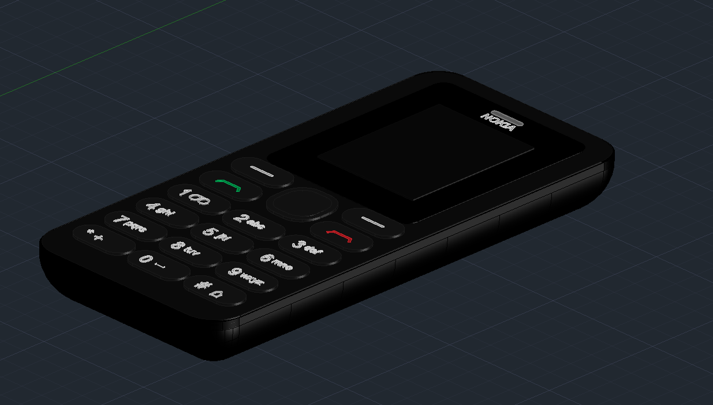

# Classic Button Phone CAD Project

This project is a technical 3D modeling study of a classic mobile phone inspired by the Nokia 108, created in Autodesk AutoCAD 2024. The model includes the main housing, front panel, keypad, battery, and motherboard, all developed in both 2D technical drawings and 3D assemblies. The work focuses on precise geometry, layer organization, dimensioning, and realistic presentation to reproduce the structure and appearance of a legacy handset.

The project was designed as a hands-on exercise in CAD design, combining reference-based modeling, product detailing, and visualization. It highlights the full process from concept sketches to a complete virtual prototype, emphasizing accuracy, craftsmanship, and technical documentation.

## Final product

